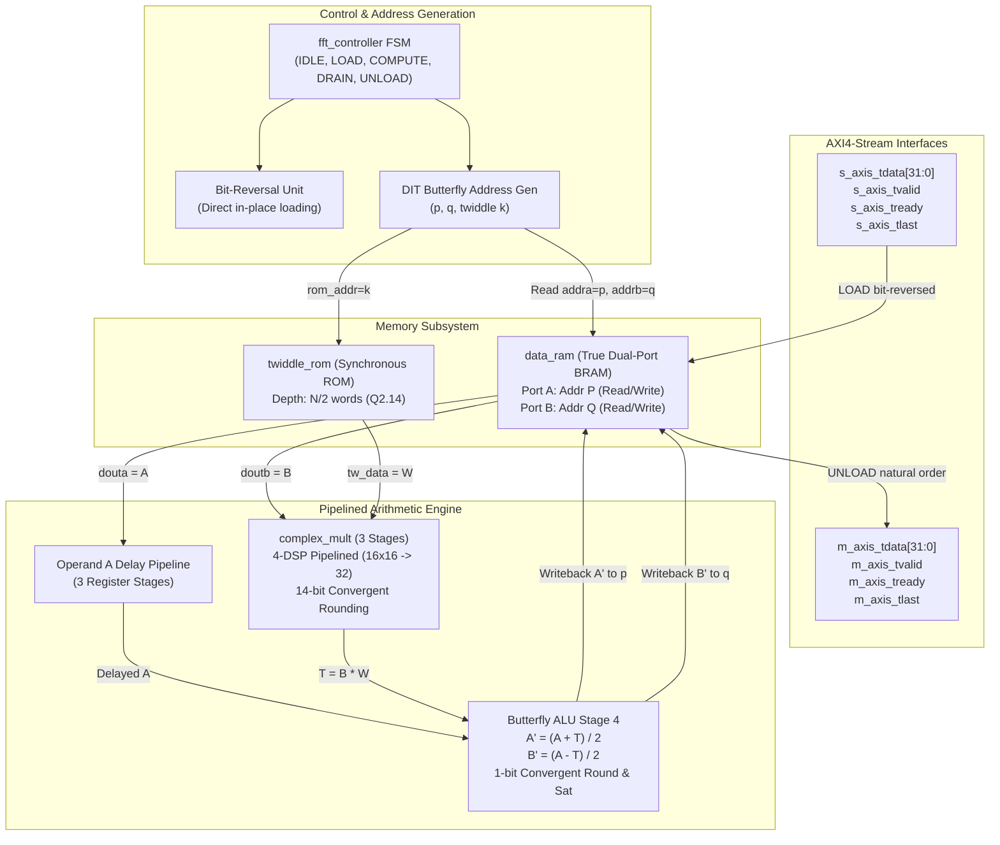

# FPGA-Based Fast Fourier Transform (FFT) Accelerator
### Iterative Single Radix-2 Decimation-In-Time (DIT) Architecture

[](#)
[](#)
[-green.svg)](#)
[-brightgreen.svg)](#)
[](#)

---

## 1. Overview

This repository contains the complete design, bit-accurate software models, verification environment, and physical FPGA implementation of a **pipelined, iterative single Radix-2 Decimation-in-Time (DIT) Fast Fourier Transform (FFT) Accelerator**. 

Targeted for real-time digital signal processing, spectral analysis, and edge sensing front-ends, the accelerator ingests streaming complex time-domain samples over standard **AXI4-Stream** (`s_axis_*`) and emits natural-order frequency bins (`m_axis_*`).

### Key Technical Highlights
- **Engine Architecture:** Single Radix-2 Butterfly reused iteratively across all $\log_2 N$ stages, slashing DSP multiplier consumption by **83.3%** compared to fully pipelined architectures.
- **Port Contention Hazard Resolved:** A scheduled **2-cycle alternating access engine** eliminates the physical 4-access/cycle True Dual-Port Block RAM bottleneck (Even cycles: Dual-Port Read; Odd cycles: Dual-Port Writeback), enabling pure Block RAM inference (`RAMB36E2`) without distributed memory overhead.
- **Precision Arithmetic:** 16-bit signed `Q1.15` complex data with 16-bit signed `Q2.14` twiddles (natively representing $+1.0 = \text{0x4000}$ and $-1.0 = \text{0xC000}$ without bypass logic).
- **Convergent Rounding:** Employs **round-to-nearest-even** tie-breaking on all stages and multiplications, completely eliminating systematic DC accumulation bias across cascaded FFT stages.
- **Two-Tier Verification:** 100% exact bit-accurate agreement (**$0\text{ LSB}$ mismatch across 60 automated regression test suites**) between SystemVerilog RTL and the Python golden model, combined with high spectral fidelity ($> 67.8\text{ dB}$ SQNR on noise, $> 114.9\text{ dB}$ on tones).
- **Physical Timing Closure:** Implemented and post-route timing closed on an **AMD Alveo U50 Accelerator Card (`xcu50-fsvh2104-2-e`)** at $100.0\text{ MHz}$ ($10.0\text{ ns}$ period) with **$+6.706\text{ ns}$ WNS**, achieving a derived maximum operating frequency of **$303.58\text{ MHz}$** while drawing only **$4\text{ mW}$** dynamic logic power.

---

## 2. Architecture & Block Diagram



---

## 3. Post-Route Implementation Results (AMD Alveo U50)

Post-implementation metrics from AMD Vivado Design Suite 2026.1 targeting `xcu50-fsvh2104-2-e`:

| Metric | Result | Target / Constraint | Status |
| :--- | :---: | :---: | :---: |
| **Worst Negative Slack (WNS)** | **$+6.706\text{ ns}$** | $\ge 0.000\text{ ns}$ | **MET (Timing Closed)** |
| **Total Negative Slack (TNS)** | **$0.000\text{ ns}$** | $0.000\text{ ns}$ | **0 Violations** |
| **Worst Hold Slack (WHS)** | **$+0.045\text{ ns}$** | $\ge 0.000\text{ ns}$ | **MET** |
| **Target Clock Frequency** | $100.00\text{ MHz}$ | $100.00\text{ MHz}$ | Target Met |
| **Derived Maximum Clock ($F_{\max}$)** | **$303.58\text{ MHz}$** | — | **$3.04\times$ Design Margin** |
| **CLB LUTs** | **387** | 871,680 | 0.04% |
| **CLB Registers (FF)** | **325** | 1,743,360 | 0.02% |
| **Block RAM (RAMB36E2)** | **1** | 1,344 | 0.07% |
| **DSP Slices (DSP48E2)** | **4** | 5,952 | 0.07% |
| **Dynamic Logic Power** | **$4\text{ mW}$** | — | Ultra-Low Power |

---

## 4. Latency & Real-Time Throughput Profile (N=64 MVP)

Under a 100 MHz clock ($10.0\text{ ns}$):
- **Sample Ingestion (`LOAD`):** 65 cycles ($0.65\ \mu\text{s}$)
- **Butterfly Computation (`COMPUTE`):** 414 cycles ($4.14\ \mu\text{s}$) [192 butterflies @ 2 cycles + inter-stage pipeline flushes]
- **Bin Egress (`UNLOAD`):** 64 cycles ($0.64\ \mu\text{s}$)
- **Total Frame Execution Time:** **543 clock cycles ($5.43\ \mu\text{s}$)**
- **Transform Throughput:** **$\approx 184,162\text{ transforms / second}$**

---

## 5. Verification Summary

Automated SystemVerilog regression executed in AMD Vivado Simulator (`xsim`) across all supported FFT sizes ($N \in \{4, 8, 16, 32, 64\}$) and all 12 canonical test classes (zeros, impulse, delayed impulse, DC, bin-centered tone, off-bin tone, two-tone, complex exponential, uniform random noise, gaussian noise, positive full scale, negative full scale):

```
======================================================================
  Vivado Automated Regression Suite Summary (scripts/run_regression.py)
======================================================================
   N | Stages | Butterflies | Tests Run | Mismatches | Vivado Runtime | Status
------------------------------------------------------------------------------
   4 |    2   |       4     |    12     |      0     |     2.98 s     |  PASS
   8 |    3   |      12     |    12     |      0     |     3.11 s     |  PASS
  16 |    4   |      32     |    12     |      0     |     3.06 s     |  PASS
  32 |    5   |      80     |    12     |      0     |     3.02 s     |  PASS
  64 |    6   |     192     |    12     |      0     |     3.00 s     |  PASS
------------------------------------------------------------------------------
>>> OVERALL REGRESSION STATUS: 60/60 SUITES PASSED (0 LSB MISMATCH) <<<
```

In addition, [`tb/tb_fft_protocol_stress.sv`](tb/tb_fft_protocol_stress.sv) verifies:
- Randomized input bubbles (`s_axis_tvalid` gaps)
- Downstream backpressure stalls (`m_axis_tready` deassertion)
- Back-to-back contiguous multi-frame processing
- Mid-frame synchronous reset recovery

---

## 6. Repository Structure

```text
fpga_fft_accelerator/
├── config/
│   └── project_spec.json               # Central architectural parameter specification
├── constraints/
│   └── timing.xdc                      # 100 MHz clock & I/O timing constraints
├── model/
│   ├── fft_float.py                    # Double-precision reference model & SQNR calculator
│   ├── fft_fixed.py                    # Bit-accurate fixed-point model (convergent rounding)
│   ├── gen_twiddles.py                 # Twiddle factor ROM generator (.mem format)
│   ├── gen_vectors.py                  # Generates stimulus & expected golden vectors (12 classes)
│   └── sweep_precision.py              # Word length & scaling policy trade-off study
├── rtl/
│   ├── fixed_point_pkg.sv              # Complex types, convergent round & saturate functions
│   ├── complex_mult.sv                 # 3-stage pipelined 4-DSP complex multiplier
│   ├── butterfly.sv                    # 4-stage pipelined radix-2 DIT butterfly with scaling
│   ├── data_ram.sv                     # True Dual-Port Block RAM (32-bit width)
│   ├── twiddle_rom.sv                  # Synchronous ROM initialized via $readmemh
│   ├── fft_controller.sv               # FSM, in-place bit-reversed addressing, pipeline drain
│   └── fft_top.sv                      # AXI4-Stream top-level integration wrapper
├── tb/
│   ├── tb_complex_mult.sv              # Multiplier unit testbench (57 tests)
│   ├── tb_butterfly.sv                 # Butterfly unit testbench (54 tests)
│   ├── tb_fft_top.sv                   # Top-level parameterized testbench
│   ├── tb_fft_top_n*.sv                # Testbench wrappers for N in {4, 8, 16, 32, 64}
│   ├── tb_fft_protocol_stress.sv       # Protocol stress & latency benchmark testbench
│   └── vectors/                        # 125 golden stimulus, expected & twiddle .mem files
├── scripts/
│   ├── run_sim.tcl                     # Headless Vivado simulation runner
│   ├── run_impl.tcl                    # Headless Vivado synthesis & implementation script
│   ├── run_regression.py               # Automated 60-suite regression execution script
│   ├── parse_reports.py                # Extracts post-route utilization, timing & power
│   ├── export_error_analysis.py        # Generates spectral error metrics (CSV/Markdown)
│   ├── generate_comparison_study.py    # Builds comparative scaling tables (N=16, 32, 64)
│   └── build_sas_docx.py               # Generates formal SAS submission Word document
├── reports/
│   ├── implementation_summary.csv      # Extracted post-route physical metrics
│   ├── utilization_route.rpt           # Vivado post-route utilization report
│   ├── timing_summary_route.rpt        # Vivado post-route static timing summary
│   └── power_route.rpt                 # Vivado post-route vector-less power report
└── docs/
    ├── architecture.md                 # Detailed microarchitecture & pipeline timing spec
    ├── final_report.md                 # Comprehensive project report & viva voce Q&A
    ├── comparison_tables.md            # Comparative study across N in {16, 32, 64}
    ├── SAS_Project_Report.md           # Formal academic submission report (Sections A-I)
    ├── FPGA_FFT_Accelerator_SAS_Report.docx # Formatted Word report matching SAS template
    └── phase_reports/                  # Individual reports for Phases 0 through 6
```

---

## 7. How to Reproduce

### Prerequisites
- AMD Vivado Design Suite (v2020.1 or newer; tested on **v2026.1**)
- Python 3.10+ with `numpy` and `python-docx`

### 1. Run Unit Tests & Automated System Regression
```powershell
python scripts/run_regression.py
```

### 2. Run Protocol Stress & Latency Profiling
```powershell
$env:PATH = "C:\AMDDesignTools\2026.1\Vivado\bin;" + $env:PATH
xvlog -sv rtl/fixed_point_pkg.sv rtl/complex_mult.sv rtl/butterfly.sv rtl/twiddle_rom.sv rtl/data_ram.sv rtl/fft_controller.sv rtl/fft_top.sv tb/tb_fft_protocol_stress.sv
xelab -debug typical -top work.tb_fft_protocol_stress -snapshot tb_fft_protocol_stress_snapshot
xsim tb_fft_protocol_stress_snapshot -R
```

### 3. Run Physical Synthesis & Implementation
```powershell
$env:PATH = "C:\AMDDesignTools\2026.1\Vivado\bin;" + $env:PATH
vivado -mode batch -source scripts/run_impl.tcl
python scripts/parse_reports.py
```

---

## 8. License & Course Mapping
Developed for **Signals and Systems (ECE-202) — Course Project / Hands-on Assignment (Module 4, CO-4)**.
Distributed under the MIT License.
