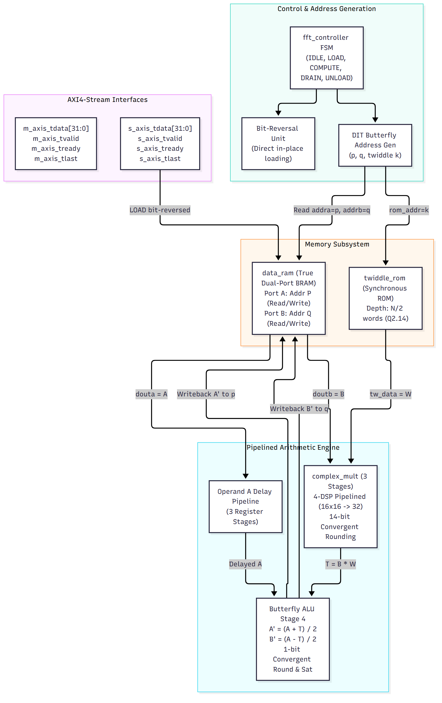
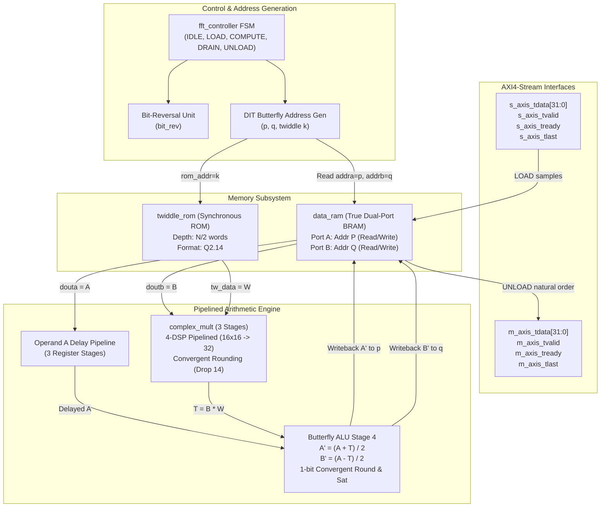
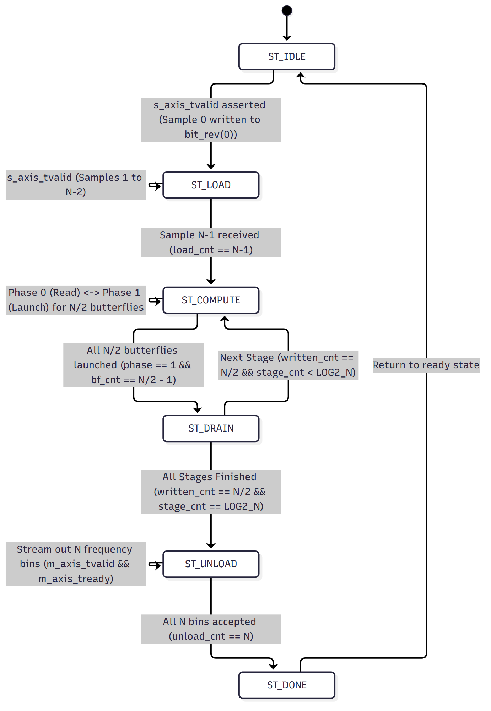
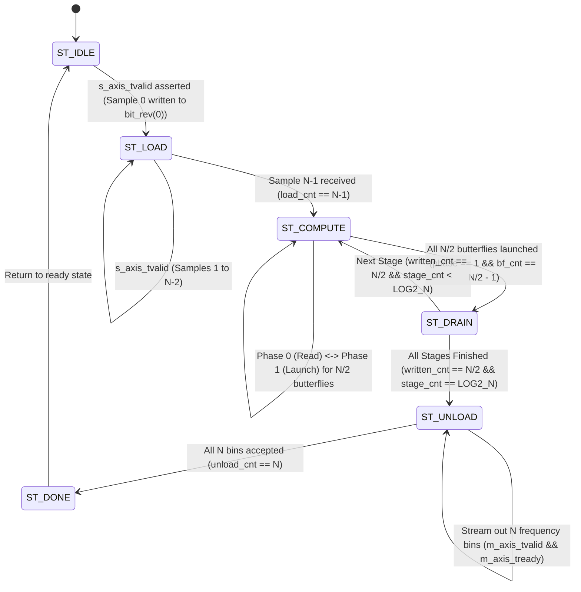

# Architecture & Microarchitectural Specification: FPGA FFT Accelerator

This document details the microarchitecture, memory subsystem, pipeline timing, and control logic for the **Iterative Single Radix-2 Butterfly FFT Accelerator**.

---

## 1. Top-Level Architectural Block Diagram



<details>
<summary>Click to view Mermaid Source</summary>


</details>

---

## 2. Memory Subsystem & Port Contention Resolution

### The 4-Access/Cycle Hazard
In a conventional 1-butterfly/cycle architecture, each butterfly requires reading 2 operands ($A$ and $B$) and writing 2 results ($A'$ and $B'$). This mandates 4 memory ports per cycle, which exceeds the physical 2-port limit of standard FPGA True Dual-Port Block RAMs (`RAMB18` / `RAMB36`), forcing Vivado to infer distributed LUTRAM or insert pipeline stalls.

### The 2-Cycle Scheduled True Dual-Port Solution
Our design uses a **2-phase scheduled memory access engine**:
- **Even Clock Cycles (Phase 0 - Read Phase):**
  - Port A reads address $p$ (`ena=1, wea=0, addra=p`).
  - Port B reads address $q$ (`enb=1, web=0, addrb=q`).
  - Twiddle ROM reads index $k$ (`rom_en=1, rom_addr=k`).
- **Odd Clock Cycles (Phase 1 - Write Phase / Launch):**
  - Registered operands $A, B$ and twiddle factor $W$ are launched into the arithmetic pipeline (`bf_valid_in=1`).
  - Memory read buses are idle. When completed butterflies emerge from the 4-cycle pipeline, Port A and Port B perform dual-port writebacks:
  - Port A writes $A'$ to destination $p$ (`ena=1, wea=1, addra=p_out`).
  - Port B writes $B'$ to destination $q$ (`enb=1, web=1, addrb=q_out`).

**Result:** Zero port contention, 100% hazard-free in-place operation, and dedicated Block RAM inference with 0 LUTRAM overhead.

---

## 3. Pipeline Timing Diagram

The butterfly datapath has an exact 4-cycle deterministic latency:
- **Cycle $t=0$:** RAM/ROM address issued ($p, q, k$).
- **Cycle $t=1$:** RAM and ROM synchronous read completes. Operands $A, B, W$ registered into `complex_mult` and delay pipe.
- **Cycle $t=2$ (CMULT Stage 1):** 4 real multipliers compute $P_{rr}, P_{ii}, P_{ri}, P_{ir}$ (absorbed into DSP48E2).
- **Cycle $t=3$ (CMULT Stage 2):** 33-bit addition/subtraction: $T_{r,\text{raw}} = P_{rr} - P_{ii}$, $T_{i,\text{raw}} = P_{ri} + P_{ir}$.
- **Cycle $t=4$ (CMULT Stage 3):** 14-bit convergent rounding and saturation $\rightarrow$ $T = (T_r, T_i)$ ready.
- **Cycle $t=5$ (Butterfly Stage 4):** Add/sub with stage scaling: $A' = (A + T)/2$, $B' = (A - T)/2$ via 1-bit convergent rounding. Output written back to RAM!

```text
Clock Cycle:   0     1     2     3     4     5     6     7     8
Phase:        [RD]  [WR]  [RD]  [WR]  [RD]  [WR]  [RD]  [WR]  [RD]
RAM Port A:   Rd(0)  --   Rd(2)  --   Rd(4) Wr(0) Rd(6) Wr(2) Rd(8)
RAM Port B:   Rd(1)  --   Rd(3)  --   Rd(5) Wr(1) Rd(7) Wr(3) Rd(9)
CMULT Pipe:    --   BF0   BF0   BF0    --    --    --    --    --
BF ALU Out:    --    --    --    --    --   BF0'   --   BF1'   --
```

---

## 4. FSM Controller State Transition



<details>
<summary>Click to view Mermaid Source</summary>


</details>

---

## 5. Address Generation Mathematics

For an $N$-point FFT with $S = \log_2 N$ stages:
- At stage $s \in [1, S]$:
  - Half-length: $L = 2^{s-1}$
  - Step size: $2L = 2^s$
  - Twiddle step: $\Delta k = N / 2^s$
- For butterfly index $j_{\text{cnt}} \in [0, N/2 - 1]$:
  - Local index: $j = j_{\text{cnt}} \ \& \ (L - 1)$
  - Group base: $\text{group} = (j_{\text{cnt}} \gg (s - 1)) \ll s$
  - Primary Address: $p = \text{group} + j$
  - Secondary Address: $q = p + L$
  - Twiddle Factor Index: $k = j \times \Delta k$
